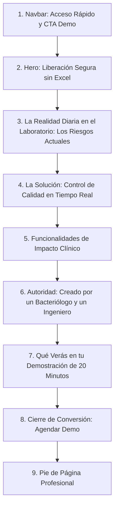

# AnalyteQC — Estructura de Contenido y Copy de la Landing Page (Enfoque Comercial & Demo)

Documento maestro de arquitectura de información, narrativa persuasiva y copy final para la landing page de **AnalyteQC**, diseñada específicamente para **comunicar el valor clínico y vender la demostración guiada (Demo)** a directores y bacteriólogos de laboratorio.

---

## 1. Estrategia de Comunicación y Posicionamiento

- **Objetivo Principal:** Convertir visitas de directores de laboratorio, coordinadores de calidad y bacteriólogos en **solicitudes de demostración personalizada (Demo)**.
- **Audiencia Objetivo:** 
  - Directores Técnicos y Propietarios de Laboratorios Clínicos.
  - Jefes y Coordinadores de Calidad / Gestión de Calidad.
  - Bacteriólogos, Microbiólogos y Químicos Clínicos a cargo de las secciones analíticas (Química, Inmunología, Hematología, etc.).
- **Tono y Lenguaje:** 
  - **Lenguaje técnico del profesional de laboratorio:** Cartas Levey-Jennings, multirreglas de Westgard, coeficientes de variación ($CV\%$), error aleatorio vs. sistemático, niveles de control ($L_1, L_2, L_3$), límites de inserción, corridas analíticas y no conformidades.
  - **Cero jerga informática interna:** No hablar de APIs, bases de datos relacionales, JSON ni frameworks de programación. El cliente evalúa la seguridad analítica, el ahorro de tiempo y el respaldo ante auditorías.
- **Factor Diferencial de Confianza (Autoridad Fundadora):** 
  - La herramienta está co-creada por la alianza estratégica indispensable: **un Bacteriólogo** (que vive los turnos de guardia, la presión por liberar muestras y el rigor clínico) y **un Ingeniero en Sistemas** (que garantiza una plataforma ágil, estable y sin errores).

---

## 2. Arquitectura de Navegación y Secciones

---

## 3. Copywriting Definitivo por Sección

---

### Sección 1: Navegación Superior (`Navbar`)

- **Logo:** `AnalyteQC` (Isotipo de precisión analítica + marca).
- **Enlaces de Menú:**
  - `El Problema del Excel` (`#el-problema`)
  - `Solución Analítica` (`#solucion`)
  - `Por qué AnalyteQC` (`#beneficios`)
  - `Quiénes Somos` (`#fundadores`)
- **Botón Destacado (CTA):**
  - **Texto:** `"Solicitar Demo para mi Laboratorio"`
  - **Estilo:** Botón de acción con color de acento cian, siempre visible.

---

### Sección 2: Hero Section (`Propuesta de Valor Principal`)

**Objetivo:** Captar el dolor del profesional en los primeros 3 segundos y motivarlo a solicitar la demo.

- **Pill Superior (Badge de Nicho):**
  `SISTEMA DE CONTROL DE CALIDAD INTERNO (CCI) PARA LABORATORIOS CLÍNICOS`

- **Titular Principal (H1):**
  > **Libera corridas analíticas con absoluta certeza y dile adiós a las hojas de cálculo.**

- **Subtitular:**
  > Estandariza la interpretación de tus cartas **Levey-Jennings** y la aplicación de las multirreglas de **Westgard** en una plataforma diseñada exclusivamente para la rutina del bacteriólogo. Protege a tus pacientes, ahorra horas de transcripción y mantén tu laboratorio permanentemente preparado para auditorías **ISO 15189**.

- **Acciones Principales (CTAs Hero):**
  - **CTA Primario:** `"Agendar Demostración Guiada"` *(Botón destacado cian)*
  - **CTA Secundario:** `"Ver Cómo Funciona en 2 Minutos"` *(Botón estilo contorno)*

- **Micro-Garantías de Conversión (Debajo de los botones):**
  - ✓ Demo en vivo de 20 minutos adaptada a tus autoanalizadores.
  - ✓ Sin costo ni compromisos comerciales.
  - ✓ Creado por profesionales de la salud e ingeniería.

- **Elemento Gráfico Hero:**
  - Vista previa de alta fidelidad de una carta Levey-Jennings interactiva:
    - 3 niveles de control simultáneos ($L_1$ Normal, $L_2$ Patológico, $L_3$ Patológico Alto).
    - Bandas claras de media y desviaciones ($\pm 1s, \pm 2s, \pm 3s$).
    - Veredicto visual inmediato: indicador verde en corridas conformes y alerta ámbar/roja con la regla infringida identificada (ej. `Regla 2₂s violada en Nivel 2`).

---

### Sección 3: La Realidad Diaria del Laboratorio (`El Problema`)

**Objetivo:** Generar empatía profunda y evidenciar que conocemos a la perfección los riesgos de operar con métodos tradicionales.

- **Pill:** `EL RETO DE LA RUTINA ANALÍTICA`
- **Titular (H2):**
  > **¿Tu control de calidad te da tranquilidad o te quita tiempo valioso?**

- **Las 3 Fricciones Reales en el Laboratorio:**
  1. **El peligro de las fórmulas en Excel:**
     Hojas de cálculo creadas internamente que se desconfiguran con facilidad, fórmulas borradas por accidente y valores de control que se transcriben a mano bajo la presión de la primera tanda de pacientes de la mañana.
  2. **Disparidad de criterios entre turnos:**
     Lo que para el bacteriólogo de la mañana es una simple advertencia ($1_{2s}$), para el del turno de la tarde se pasa por alto o se rechaza sin un protocolo uniforme. Falta un criterio institucional unificado.
  3. **Angustia antes de una auditoría de acreditación:**
     Correr a buscar carpetas físicas o archivos dispersos para justificar por qué se aceptó un lote, dónde está la acción correctiva de un desvío o quién autorizó la liberación de una corrida analítica.

---

### Sección 4: La Solución AnalyteQC (`Beneficios de Negocio y Operación`)

**Objetivo:** Explicar cómo AnalyteQC transforma la operación diaria en lenguaje de laboratorio.

- **Pill:** `PRECISIÓN SIN COMPLICACIONES`
- **Titular (H2):**
  > **Un criterio analítico único, automático e inmutable para todo tu equipo.**

- **Bloques de Solución:**

  - **1. Evaluación Instantánea de Reglas de Westgard:**
    Al ingresar el valor del control, el sistema evalúa inmediatamente el histórico de la serie analítica ($1_{2s}, 1_{3s}, 2_{2s}, R_{4s}, 4_{1s}, 10_x$). Clasifica en el acto si te enfrentas a un **error aleatorio** (ej. burbujas en reactivo, pipeteo) o a un **error sistemático** (ej. degradación de calibrador, lámpara agotada), guiando al profesional hacia la solución correcta.

  - **2. Cartas Levey-Jennings Dinámicas por Lote y Nivel:**
    Visualiza tus controles en tiempo real. Configura límites fijos de fábrica o límites móviles calculados a partir de los datos acumulados de tu propio laboratorio ($CV\%$ real vs. $CV\%$ diana).

  - **3. Cierre de No Conformidades y Trazabilidad Total:**
    Si una corrida es rechazada, AnalyteQC bloquea la liberación del analito hasta que el bacteriólogo registre la causa raíz y la **acción correctiva tomada** (ej. recalibración, apertura de nuevo vial de reactivo). Todo queda firmado digitalmente con fecha, hora y responsable.

  - **4. Transición de Lotes de Control sin Sobresaltos:**
    Administra lotes activos, provisionales y cerrados. Realiza el solapamiento de lotes (*crossover*) de manera transparente para calcular las nuevas medias de trabajo sin perder el histórico del lote saliente.

---

### Sección 5: Cuadro Comparativo (`¿Por qué dar el salto a AnalyteQC?`)

| Desafío en el Laboratorio | Control Manual / Hojas de Cálculo | Con AnalyteQC en tu Rutina |
| :--- | :--- | :--- |
| **Tiempo por corrida de control** | 10 a 15 minutos buscando plantillas y anotando. | **Menos de 60 segundos** por equipo. |
| **Aplicación de reglas Westgard** | Sujeta a memoria e interpretación de cada analista. | **Automática y estandarizada** en cada corrida. |
| **Detección de tendencias y sesgos** | Difícil de notar a simple vista en tablas numéricas. | **Identificación visual inmediata** de desplazamientos (*shifts* y *trends*). |
| **Registro de acciones correctivas** | Cuadernos de bitácora propensos a extravío o incompletos. | **Digital, obligatorio y respaldado** para auditoría. |
| **Auditorías ISO 15189 / Entes de Salud** | Semanas de preparación y recopilación de evidencias. | **Informes consolidados y trazabilidad** en un clic. |

---

### Sección 6: Autoridad y Confianza (`Quiénes Están Detrás de AnalyteQC`)

**Objetivo:** Generar máxima credibilidad demostrando que no es un software genérico hecho por programadores aislados, sino una herramienta nacida de la práctica biomédica real.

- **Pill:** `NUESTRO EQUIPO FUNDADOR`
- **Titular (H2):**
  > **La sinergia indispensable: Rigor Biomédico + Ingeniería de Precisión.**

- **Subtítulo:**
  > No creemos en el software desarrollado desde un escritorio distante. AnalyteQC nació de unir la experiencia directa frente al autoanalizador con la mejor arquitectura tecnológica.

- **Tarjeta 1 — El Bacteriólogo:**
  - **Rol:** *Cofundador & Especialista en Calidad de Laboratorio*
  - **Aporte al producto:**
    > *"Conozco la tensión de tener muestras urgentes de pacientes esperando en la gradilla mientras dudas si el control de química pasó o no. Diseñé la lógica de AnalyteQC para responder exactamente a lo que el bacteriólogo necesita saber en 5 segundos: ¿mi autoanalizador es confiable hoy para emitir diagnósticos seguros?"*
  - **Foco:** Criterio clínico, normatividad ISO 15189, usabilidad en la mesa de trabajo, gestión de controles patológicos y normales.

- **Tarjeta 2 — El Ingeniero en Sistemas:**
  - **Rol:** *Cofundador & Arquitecto de Software*
  - **Aporte al producto:**
    > *"Mi misión es que la plataforma jamás sea un obstáculo, sino un motor transparente. Construimos una experiencia ultrarrápida, con cálculos matemáticos deterministas sin margen de error, interfaces limpias que no saturan la vista y seguridad absoluta en la custodia de los datos del laboratorio."*
  - **Foco:** Precisión algorítmica, alta disponibilidad, experiencia de usuario fluida, integridad y respaldo inmutable de datos.

---

### Sección 7: Qué vas a Descubrir en tu Demo (`Expectativas Claras`)

**Objetivo:** Reducir la fricción para solicitar la demo mostrando que no será una venta agresiva, sino una sesión clínica práctica.

- **Pill:** `DEMOSTRACIÓN PERSONALIZADA`
- **Titular (H2):**
  > **20 minutos que transformarán la gestión de calidad en tu laboratorio.**

- **El Recorrido de la Demostración:**
  1. **Configuración de tus analitos y controles:**
     Verás qué tan sencillo es registrar tus equipos y los controles que utilizas hoy en tu sección analítica.
  2. **Simulación de una corrida real:**
     Ingresaremos valores de prueba y observarás cómo el sistema detecta violaciones sutiles que en Excel suelen pasar desapercibidas.
  3. **Resolución de no conformidades en vivo:**
     Experimentarás el flujo guiado para documentar acciones correctivas y cómo queda blindada la evidencia para tus auditores.
  4. **Sesión de preguntas técnicas con los fundadores:**
     Atenderemos tus dudas directamente entre profesionales (bacteriólogo a bacteriólogo e ingeniero a tu equipo técnico).

---

### Sección 8: Llamado a la Acción Principal (`Final Conversion Banner`)

- **Fondo:** Caja destacada con gradiente cian oscuro y borde iluminado.
- **Titular:**
  > **Lleva el control de calidad de tu laboratorio al siguiente nivel.**
- **Subtítulo:**
  > Agenda hoy una sesión en vivo de 20 minutos con nosotros y descubre cómo simplificar tu rutina analítica y garantizar la máxima seguridad diagnóstica para tus pacientes.

- **Formulario / Botón de Acción:**
  - Campos simplificados (mínima fricción):
    - `Nombre y Apellido`
    - `Laboratorio / Institución`
    - `Correo Electrónico Profesional`
    - `Teléfono / WhatsApp`
  - Botón: `"Quiero mi Demostración Guiada"`

- **Garantías de Cierre:**
  - Sin costo · Adaptado a tus analizadores · Respuesta en menos de 24 horas.

---

### Sección 9: Pie de Página (`Footer`)

- **Columna 1 — Marca:**
  - `AnalyteQC`
  - Sistema de Control de Calidad Interno para Laboratorios Clínicos.
  - Desarrollado por bacteriólogos e ingenieros de sistemas.
- **Columna 2 — Secciones:**
  - `¿Por qué AnalyteQC?`
  - `Reglas de Westgard`
  - `Levey-Jennings Dinámico`
  - `Quiénes Somos`
- **Columna 3 — Soporte y Contacto:**
  - `Agendar Demostración`
  - `Contacto Directo con Fundadores`
  - `Preguntas Frecuentes`
- **Frase Final de Cierre:**
  - *"Confiabilidad analítica para la tranquilidad de tus pacientes."*
  - © 2026 AnalyteQC. Todos los derechos reservados.

---

## 4. Lineamientos de Animación con GSAP en Astro

1. **Aparición Progresiva de la Demo Levey-Jennings (Hero):**
   - Dibujo fluido de las líneas de corte ($\pm 1s, \pm 2s, \pm 3s$) y revelación escalonada de los puntos de control simulando una semana de corridas.
2. **Entrada de la Dupla Fundadora:**
   - Animación de acercamiento y foco en los perfiles del Bacteriólogo y el Ingeniero, destacando visualmente la unión entre laboratorio y tecnología.
3. **Contador de Beneficios:**
   - Animación numérica sutil para métricas de impacto (ej. *De 15 min a 60 seg*, *100% de corridas trazables*).
